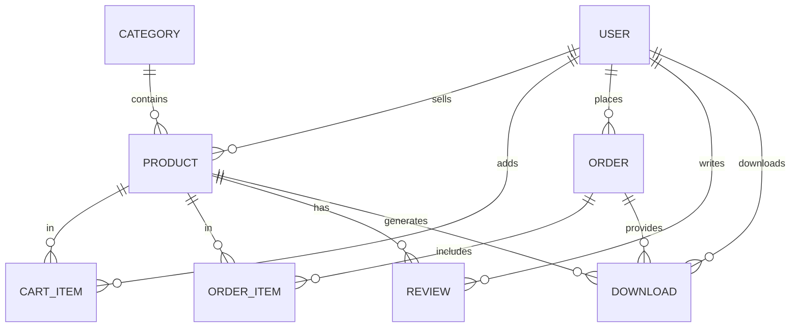

<div align="center">

# ▶ Ilania — Premium Digital Marketplace

**Better experience for effective websites. Buy & sell premium UI kits, templates, graphics, and courses.**

[](https://rg100152.github.io/ilania/)
[](https://github.com/Rg100152/ilania/blob/main/app.py)
[](https://www.python.org/)
[](https://www.sqlite.org/)
[](#license)

<br>

### 🚀 **[Click Here to Launch Live Interactive Demo](https://rg100152.github.io/ilania/)**
*Or inspect the complete single-file Python backend in [`app.py`](https://github.com/Rg100152/ilania/blob/main/app.py)*

</div>

---

## 📖 Overview

**Ilania Digital Marketplace** is a modern, dark-themed full-stack digital asset platform engineered by **[Raj Gautam](https://github.com/Rg100152)**. It connects digital creators (**Sellers**) with developers and designers (**Buyers**) under a governed **Admin** approval workflow.

This repository provides **two ready-to-run implementations**:
1. 🌐 **Interactive Web SPA (`index.html`)** — Hosted live on GitHub Pages at [**rg100152.github.io/ilania**](https://rg100152.github.io/ilania/) with an instant role switcher, 3-step checkout, and 20+ animations.
2. 🐍 **Single-File Flask Application ([`app.py`](https://github.com/Rg100152/ilania/blob/main/app.py))** — A complete, self-contained Python backend featuring **Flask**, **SQLAlchemy ORM (8 relational models)**, **Flask-Login**, inline Jinja2 templates, auto-seeded database (`market.db`), and cryptographic token-verified file downloads.

---

## ✨ Key Features

### 👤 Role-Based Ecosystem (Buyer · Seller · Admin)
- **🛍️ Buyer Portal:** Browse & filter digital assets, save to Wishlist, apply promo codes, complete a 3-step sandbox checkout, write star-rated reviews, and download purchased packages via unique cryptographic tokens.
- **🏪 Seller Studio:** Upload new digital products, track unit sales, monitor real-time creator earnings, and manage product listings.
- **🛡️ Admin Control Panel:** Platform-wide metrics dashboard (Total Users, Catalog Count, GMV) and a 1-click **Approve / Reject** queue for newly submitted seller products.

### 🎬 20+ Micro-Interactions & Dark UI Polish
- **Theme Palette:** Deep Space Dark (`#0f0f1e`), Navy Card (`#16213e`), Vibrant Orange Accent (`#ff6b35`), and Cyber Purple (`#9b59ff`).
- **Interactive Effects:**
  - ✨ **Aurora & Floating Particle Canvas** on the Hero banner
  - 🃏 **3D Card Tilt + Mouse-Following Radial Spotlight** on product cards
  - 🔄 **3D Flip Category Cards** on hover
  - 🛒 **Fly-to-Cart Clone Animation** + Cart Badge Bounce
  - 🎉 **Full-Screen Confetti Blast** upon order completion
  - 🔢 **Odometer Count-Up Stats**, **Typewriter Heading**, and **Logo Text Scramble**
  - 📜 **Top Marquee Announcement Bar** & **Scroll Progress Indicator**

---

## 🏛️ System Architecture & ER Schema

Ilania is built on a clean 8-table relational database schema (**User**, **Category**, **Product**, **CartItem**, **Order**, **OrderItem**, **Review**, **Download**):



---

## ⚡ Quick Start — Running the Flask App (`app.py`) Locally

Because the entire Flask backend, SQLAlchemy models, routes, CSS, and Jinja2 templates are unified inside [`app.py`](https://github.com/Rg100152/ilania/blob/main/app.py), you can launch the server in under 60 seconds:

### 1. Clone the Repository
```bash
git clone https://github.com/Rg100152/ilania.git
cd ilania
```

### 2. Install Dependencies
```bash
pip install flask flask-sqlalchemy flask-login
```

### 3. Run the Application
```bash
python3 app.py
```
> On first launch, `app.py` automatically creates `market.db` and seeds it with demo users, 6 categories, and 7 digital products.

### 4. Open in Browser
```text
http://127.0.0.1:5000
```

---

## 🔑 Demo Credentials & Promo Codes

You can switch accounts in **one click** using the footer/navbar role switcher, or log in manually with:

| Role | Email | Password | Capabilities |
| :--- | :--- | :--- | :--- |
| **👤 Buyer** | `buyer@test.com` | `buyer123` | Add to cart, apply coupons, checkout, download files, post reviews |
| **🏪 Seller** | `seller@test.com` | `seller123` | Access Seller Studio (`/seller/`), upload new products, track revenue |
| **🛡️ Admin** | `admin@test.com` | `admin123` | Access Admin Panel (`/admin-panel/`), approve/reject pending products |

### 🎟️ Active Checkout Promo Codes
- **`ILANIA20`** — **20% OFF** (Interactive Web SPA)
- **`SAVE10`** — **10% OFF** (Both Web SPA & Flask `app.py`)

---

## 📂 Repository Structure

```text
ilania/
├── index.html          # 🌐 Standalone Interactive SPA (Live on GitHub Pages)
├── app.py              # 🐍 Complete Single-File Flask + SQLAlchemy Web Application
├── uploads/            # 📁 Auto-created directory for seller product uploads
├── instance/
│   └── market.db       # 🗄️ Auto-generated SQLite database (seeded on first run)
└── README.md           # 📘 Project documentation
```

---

## 🛠️ Tech Stack

| Layer | Technologies Used |
| :--- | :--- |
| **Backend** | Python 3.10+, Flask 3.x, Flask-SQLAlchemy, Flask-Login, Werkzeug Security |
| **Database** | SQLite (`market.db`) — PostgreSQL ready |
| **Frontend** | HTML5, CSS3, Tailwind CSS, Jinja2 Templates, Vanilla JavaScript (ES6+) |
| **Animations** | HTML5 Canvas (Particles & Confetti), CSS3 3D Transforms, IntersectionObserver |
| **Deployment** | GitHub Pages (Frontend Demo) · Render / Railway compatible (Flask App) |

---

## 👨‍💻 Author & Creator

**Raj Gautam**  
*Full-Stack Developer & Creator of Ilania Digital Marketplace*

- 🐙 **GitHub:** [@Rg100152](https://github.com/Rg100152)
- 🌐 **Live Project:** [https://rg100152.github.io/ilania/](https://rg100152.github.io/ilania/)
- 💻 **Flask Source:** [app.py](https://github.com/Rg100152/ilania/blob/main/app.py)

---

## 📜 License

This project is open-source and available under the **MIT License**. Feel free to fork, star ⭐, and customize it for your own digital marketplace!
